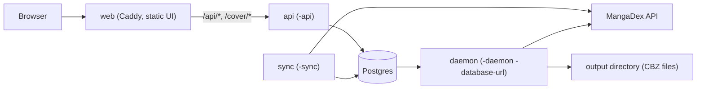

# md-downloader

Download the manga you read on [MangaDex](https://mangadex.org) for offline reading, as CBZ files that
work with Kavita, Komga and most other readers. It uses MangaDex's public API.

It is a personal tool for offline access to series you already follow. It is not affiliated with MangaDex.
Please respect the creators and groups behind the series, and MangaDex's terms of service.

## Features

- **Downloads whole series** as one CBZ per chapter (or plain image folders), at the documented rate limits.
  Reruns skip what you already have, so it is safe to interrupt and resume.
- **Queue daemon** (`-daemon`): works through a persistent queue (a file, or Postgres) one series at a time, survives restarts,
  and pauses when the output folder disappears (for example a dropped network mount) instead of failing series.
- **Library web UI** (`-library`): browse your MangaDex "Reading" list with covers, summaries, tags, ratings and
  start years. Filter by tag (include or exclude), demographic, year range and title; sort several ways;
  mark series Y or N and queue them. Series that are queued or running are locked so you cannot queue them twice.
- Only lists series that have downloadable chapters in your language, so licensed or taken-down series drop out.
- Picks a hosted copy when a chapter has both an official external link and a hosted upload.
- Retries failed pages against a fresh MangaDex image server.

## Install

Requires Go 1.25 or newer (see `go.mod`).

```sh
go build -o md-downloader ./cmd/md-downloader
```

## Modes

One binary, selected by flags. Exactly one of these is chosen per process:

| Mode | Flag | What it does | Needs |
|------|------|--------------|-------|
| One-off | `-manga <url-or-uuid>` | Downloads a single series and exits (non-zero if any chapter failed) | nothing |
| Local UI | `-library` | Web UI over your MangaDex library, with a local cache. Queues work to a daemon | credentials, a running `-daemon` |
| Daemon | `-daemon` | Works through the download queue one series at a time | an output directory; optionally `-database-url` |
| API | `-api` | Serves the web UI's HTTP API from the shared database. Meant to sit behind a reverse proxy | `-database-url` |
| Sync | `-sync` | Copies your MangaDex library into the shared database on a schedule | `-database-url`, credentials |

There are two ways to run the whole thing:

- **Single machine:** `-library` plus a `-daemon` that keeps its queue in a file under `-state-dir`. No database.
- **Split deployment:** Postgres holds the library and the queue. `-sync` fills the library, `-api` serves the UI's
  API, and `-daemon -database-url ...` downloads. The static UI is served separately (see Container images).

Migrations are embedded and applied automatically when a process connects to the database.

## Architecture



The sync process is the only one that needs your MangaDex credentials. The API never talks to MangaDex for the
library, it reads what sync stored. The daemon claims jobs from Postgres with leases and heartbeats, so a job whose
daemon died is detected and retried rather than lost.

## Credentials

Downloading a single series needs no account. `-library` and `-sync` do.

1. In MangaDex, open Settings, then API Clients, and create a personal client.
2. Copy `personal-api-token.example` to `personal-api-token` and fill it in:

   ```
   id:personal-client-...
   secret:...
   username:your-mangadex-username
   password:your-mangadex-password
   ```

3. Restrict it: `chmod 600 personal-api-token`.

You can instead set `MD_CLIENT_ID`, `MD_CLIENT_SECRET`, `MD_USERNAME` and `MD_PASSWORD`, which override the file.
`-token-file` points at a different file.

## Usage

Download one series (a title URL or its UUID):

```sh
./md-downloader -manga https://mangadex.org/title/<uuid>/<slug> -out ~/Manga
./md-downloader -manga <uuid> -from 10 -to 20 -data-saver -format dir
```

Single machine, normally as two processes:

```sh
./md-downloader -daemon -out ~/Manga -workers 8   # terminal 1: processes the queue
./md-downloader -library                           # terminal 2: web UI at http://127.0.0.1:8484
./md-downloader -library -static web   # develop the UI: files are read from disk, reload to see edits
```

Split deployment:

```sh
export DATABASE_URL=postgres://user:pass@db:5432/mdl
./md-downloader -sync -sync-interval 1h      # keep the library table current; add -once to sync once and exit
./md-downloader -api -addr 0.0.0.0:8080       # API for the web UI
./md-downloader -daemon -out /data/manga      # downloader; queue state is in Postgres
```

Keep the daemon in its own terminal or run it in the background. Do not suspend it with Ctrl-Z: it keeps
accepting connections but stops answering. Stop it with Ctrl-C or SIGTERM; the queue is kept and interrupted
series resume.

### Flags

| Flag | Default | Meaning |
|------|---------|---------|
| `-manga` | | Title URL or UUID to download |
| `-library` | off | Start the local web UI for your MangaDex library |
| `-daemon` | off | Run the queue daemon |
| `-api` | off | Serve the web API from the shared database (needs `-database-url`) |
| `-sync` | off | Sync your MangaDex library into the shared database (needs `-database-url`) |
| `-sync-interval` | `1h` | Time between syncs for `-sync` |
| `-once` | off | With `-sync`: sync once and exit |
| `-database-url` | `$DATABASE_URL` | Postgres URL. With `-daemon`, empty keeps the queue in a file under `-state-dir` |
| `-status` | `reading` | Library list to show or sync: `reading`, `on_hold`, `plan_to_read`, `dropped`, `re_reading`, `completed`, `all` |
| `-lang` | `en` | Translated language code |
| `-out` | `downloads` | Output directory (the daemon requires it to exist, or its parent to) |
| `-format` | `cbz` | `cbz` or `dir` |
| `-data-saver` | off | Compressed images, much smaller |
| `-workers` | `4` | Concurrent page downloads per chapter |
| `-from`, `-to` | | Chapter number range (single-series mode only) |
| `-ratings` | `safe,suggestive` | Content ratings: `safe,suggestive,erotica,pornographic` |
| `-addr` | `127.0.0.1:8484` | Listen address for `-library` and `-api` |
| `-daemon-addr` | `127.0.0.1:8485` | Daemon listen address, and where `-library` finds it |
| `-token-file` | `personal-api-token` | Credentials file |
| `-cache-dir` | user cache dir | Library metadata and cover cache (`-library`, and covers for `-api`) |
| `-state-dir` | user config dir | Where a file-backed daemon keeps its queue |
| `-static` | | Serve the UI from this directory instead of the embedded copy (development) |
| `-refresh` | off | Ignore cached library data |

### Environment variables

| Variable | Used by | Meaning |
|----------|---------|---------|
| `DATABASE_URL` | `-api`, `-sync`, `-daemon` | Default for `-database-url` |
| `MD_CLIENT_ID`, `MD_CLIENT_SECRET`, `MD_USERNAME`, `MD_PASSWORD` | `-library`, `-sync` | MangaDex credentials; override the token file |
| `TEST_DATABASE_URL` | tests | Postgres database for the store tests (see Development) |
| `API_UPSTREAM` | web image | Where Caddy proxies `/api/*` and `/cover/*` (default `md-downloader-api:8080`) |

Output looks like `<out>/<Series title>/ch0001.cbz`. Chapter numbers are zero-padded so they sort correctly.

## Container images

Both are published to GHCR by the `images` workflow on every push to `main` that touches code or image inputs,
tagged `sha-<short>` and `latest`. Both run as uid 1000 (a non-root user) and are built from digest-pinned bases.

| Image | Contains | Port | Needs |
|-------|----------|------|-------|
| `ghcr.io/xiiisins/md-downloader` | The Go binary on distroless static, no shell. Entrypoint `/md-downloader`; the mode is the container args | none exposed | see below |
| `ghcr.io/xiiisins/md-downloader-web` | Caddy serving the static UI over plain HTTP, `/healthz`, and a reverse proxy for `/api/*` and `/cover/*` | `8080` | `API_UPSTREAM` if the API is not at `md-downloader-api:8080` |

The Go image has no `EXPOSE` and its listen addresses default to `127.0.0.1`, so pass `-addr 0.0.0.0:8080` for
`-api`. Its working directory is `/data`, with `HOME=/data`, `XDG_CACHE_HOME=/data/cache` and
`XDG_CONFIG_HOME=/data/state`. What each mode needs:

- `-api`: `DATABASE_URL`, and a writable `/data` (cover cache).
- `-sync`: `DATABASE_URL` and the four `MD_*` variables.
- `-daemon -database-url ...`: `DATABASE_URL` and a volume for `-out`. Mounts must be writable by uid 1000.

```sh
docker run --rm -e DATABASE_URL=... ghcr.io/xiiisins/md-downloader -api -addr 0.0.0.0:8080
docker run --rm -p 8080:8080 -e API_UPSTREAM=api-host:8080 ghcr.io/xiiisins/md-downloader-web
```

The `Dockerfile` and `Caddyfile` are at the repo root and `web/Dockerfile` builds the web image from the repo root
(`docker build -f web/Dockerfile .`). A `.dockerignore` allowlist keeps credentials out of the build context.

## How it behaves

- **Rate limits:** API calls are spaced to stay under MangaDex's limits, chapters are fetched one at a time,
  and `429` responses are honoured.
- **Caching:** library titles, tags, ratings and covers are cached on disk (titles for 24 hours, chapter
  availability for 6 hours), so relaunching the UI is fast. Use `-refresh` to force a reload.
- **Reports:** after each image it tells the MangaDex network how the download went, as they ask. If that
  endpoint is failing, reporting pauses for ten minutes and never slows downloads.
- **Local by default:** `-library` and the daemon bind to `127.0.0.1` and reject requests with an unexpected `Host`
  header (except `/healthz`). `-api` does not do this check; put it behind a reverse proxy and do not expose it directly.

## Development

```sh
git config core.hooksPath .githooks   # enable the secret-scanning pre-commit hook
go vet ./... && go test -race ./...
```

The Postgres store tests are skipped unless `TEST_DATABASE_URL` is set. They empty the jobs table, so point it at a
throwaway database, never one with real data:

```sh
docker run --rm -d -p 5432:5432 -e POSTGRES_HOST_AUTH_METHOD=trust postgres:17
TEST_DATABASE_URL='postgres://postgres@localhost:5432/postgres?sslmode=disable' go test -race -count=1 ./...
```

CI runs gofmt, vet, build, tests against a Postgres service, and a gitleaks scan of the full history. Changes go
through pull requests into `main`, which are squash-merged once the `CI gate` check passes.

### Handling secrets

- `personal-api-token` is git-ignored and must never be committed, pasted into issues, or copied into an image.
  Keep it `chmod 600`. Use the `MD_*` variables or your platform's secret store in deployments.
- The pre-commit hook blocks staged credential files (token file, `.env*`, `*.pem`, `*.key` and similar), any value
  from your local `personal-api-token`, and gitleaks findings. It does not replace care: stage files by explicit
  path rather than `git add -A`.
- Keep internal hostnames, IP addresses and database URLs out of commits, docs and issues. This repository is public.

## License

MIT, see [LICENSE](LICENSE).
